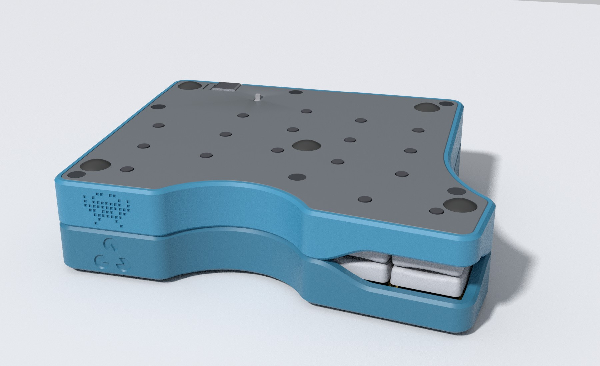
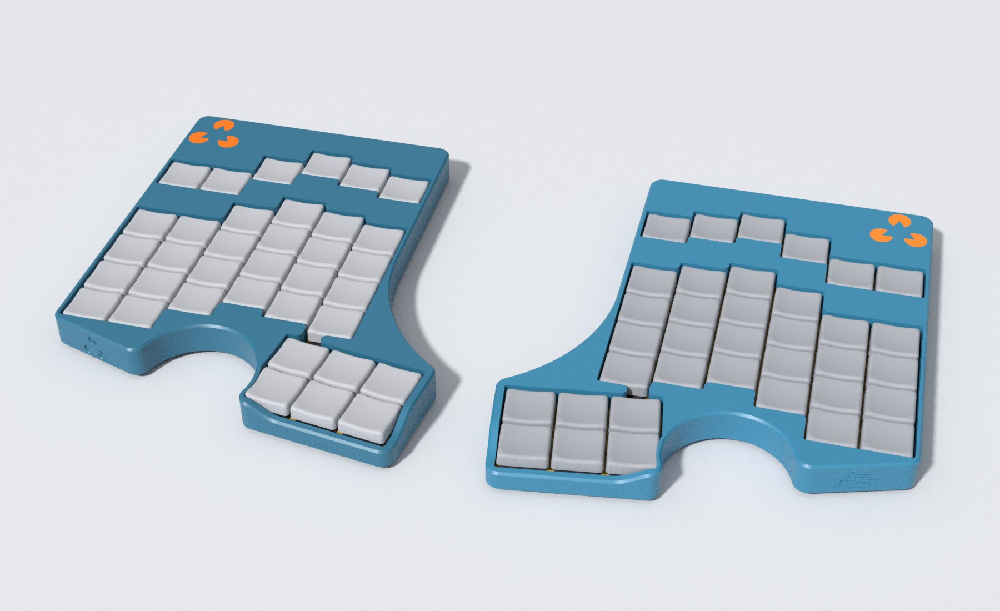
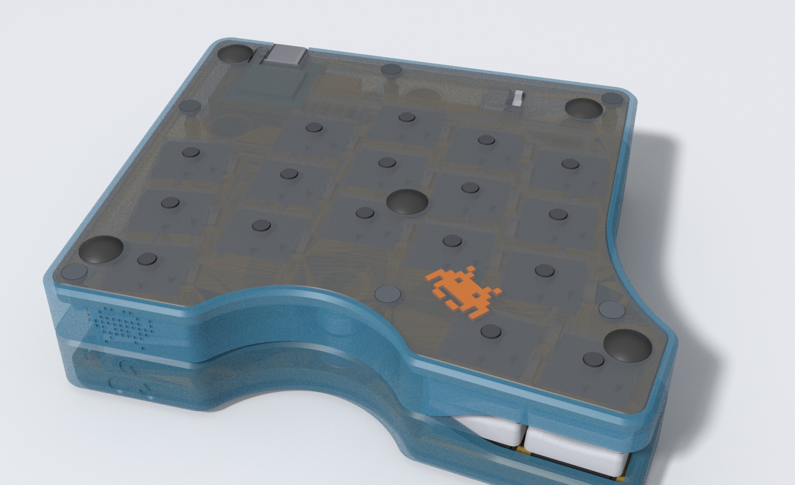

# duality_wave

A split, hand-wired, low-profile keyboard with a 3D-printed case.
Each half has 17 Kailh Choc keys and a Seeed XIAO nRF52840.
The case is generated from code, so you can change the layout and print it again.

## Status

The case design is in progress.
Nobody has printed or assembled the full case yet.
Fit values can still change after the first prints.
There is no firmware yet.
The images are renders, not photos.

## Features

- 17 keys per half: 3 rows of 5 finger columns and 2 thumb keys.
- 8 degree splayed pinky column, staggered finger columns and an angled thumb cluster.
- Low profile. Each half is about 113 x 97 x 12.8 mm.
- Protective walls around the keys for secure transportation
- Hand-wired. There is no PCB.
- One XIAO nRF52840, one LiPo battery and one slide power switch in each half.
- USB-C port on each half.
- A flexible lever in the bottom plate presses the XIAO reset button.
- Magnets hold the two halves together.
- Five rubber bumpers in each half.
- No snap fits. Heat-set inserts and M2 screws hold the case together.

## Other layouts

The case generator also works with other key layouts, for example Corne, Absolem or layouts with extra rows, columns as well as double-rowed thumb clusters. See [docs/LAYOUTS.md](docs/LAYOUTS.md).

## Bill of materials

Quantities are for both halves.

- 34 Kailh Choc v1 switches
- 34 low-profile keycaps with Choc spacing (17.45 x 16.45 mm), for example [Hattara](https://github.com/Pelicram/Hattara-Printable-Low-Profile-Keycaps)
- 2 Seeed XIAO nRF52840
- 2 LiPo batteries, 31 x 17 x 6 mm
- 2 slide power switches, 9 x 3.4 x 4 mm
- 16 magnets, 10 mm diameter, 2 mm thick (two stacked in each of 8 pockets)
- 12 M2 heat-set inserts, 3.5 mm outer diameter, 2 mm long
- 12 low-profile M2 screws, 6 mm long
- 10 rubber bumpers, 8 mm diameter
- 34 diodes, one per key
- 0.1 mm to 0.2 mm enamelled wire

The Hattara keycaps are designed for SLS and MJF printing.
Check the repository of the keycaps for the files and the license.

## Printing

Each half has three printed parts.
The magnet spacers are a fourth kind of part, and both halves share them.

- `keywell` is the top shell.
- `keyplate` holds the switches.
- `bottom` closes the case.
- `magnet_spacer` is a small disc. Print 8 of them, 4 for each half.

Run `task export-case` to create the STEP files for all parts.
Each STEP file is in its print orientation, so you do not flip it in the slicer.
The keywell and the keyplate print upside down compared to the assembled case.
Run `task export-coupon` to create the calibration coupons.
Print the coupons first.
The fit depends on your printer, your material and your slicer.

## Assembly

1. Press an M2 heat-set insert into each of the six holes of the keywell. Press each insert in until it is flush with the keywell face.
2. Lay the keywell upside down. Glue two magnets on top of each other and put each pair into a magnet pocket from below. A thin skin of the keywell covers the magnets on the outside. See the section about polarity. Put a spacer disc on each pair of magnets.
3. Wire the switches, the diodes, the XIAO, the power switch and the battery. Wiring is your choice. The keyplate has channels for the wire and the bottom plate has recesses for the switch pins and the diodes.
4. Put the keyplate into the keywell. It holds the spacers and the magnets. Then put the bottom plate on top. Fasten the six M2 screws from the bottom.
5. Put the rubber bumpers into their recesses.

Both halves are mostly mirror images of each other.

### Magnet polarity

Only the relative polarity matters.
Place the magnets in one half however you want.
Use a magnetized tool to make sure the magnets in the other half face the opposite way.
Fit the keyplate before you bring the halves together.
Without the spacers and the keyplate, magnets that repel each other push out of their pockets.

## Fit calibration

All fit constants live in `PrintProfile` in `src/duality_wave/models/print_profile.py`.
`CaseDimensions` carries one profile in `print_profile`.
The defaults match a Bambu Lab printer with PLA.
Change the profile for every new printer, material or slicer.

1. Run `task export-coupon`.
2. Print `build/coupons/coupons_hardware.stl` and `build/coupons/coupons_plate_wiring_engraving.stl` with the same settings as the final case.
3. Find the tightest fit that still goes together by hand.
4. Copy the winning values into a `PrintProfile`.

The coupons are built in their real print orientation.
The magnet coupons have the skin on the print bed, like the keywell.
They reuse the cutters from `models/features.py`.
Each plate fits the usable area of a Bambu Lab A1 mini: 170 x 170 mm of the 180 x 180 mm bed.

| Coupon | Question |
| --- | --- |
| A, switch plate | Which switch cutout size is right? Does corner relief help? |
| B, plate in cavity (second plate) | Which plate clearance is right? Try each plate both ways round. |
| C, insert pilots | Which insert pilot size is right? Press an insert into each hole. |
| D, pockets | Which XIAO pocket clearance is right? Which battery pocket clearance is right? Test the real battery. |
| E, magnet pockets | Which magnet pocket size is right? The label is the pocket diameter. Push a stack of two magnets into each pocket. |
| E, skin and mate | How thick can the skin over the magnets be? The label is the skin in mm. Put a stack of two magnets in a pocket, then hold a loose magnet on the skin side. |
| F, trenches (second plate) | Which trench width and depth is right for the enamelled wire? Rows are the width in mm, columns the depth. Press a wire into each trench. |
| G, diode pockets (second plate) | How much slack does the diode pocket need? The label is the slack in mm (the pocket is that much wider, twice as much longer and that much deeper than the body). Lay a real diode into each pocket. |

Print the mate of the skin coupon too.

The second plate holds the plate fit (B), the trenches (F), the diode pockets (G) and the wall slabs for the emblems.
It is the file `build/coupons/coupons_plate_wiring_engraving.stl`.
Coupons B, F and G are in the table above.

The emblems in the front wall are on four wall slabs of the second plate, one for each combination of pocket depth (0.4 and 0.8 mm) and roof (sloped and straight).
Each slab carries three space invaders with a pixel gap of 0, 0.2 and 0.4 mm, and the symbol.
The label under an invader is its gap.
The label under the symbol is the depth in mm and the roof (`45` is sloped).
The slabs stand on their rim, like the wall of the keywell.
The emblems are upside down on the plate, because the keywell prints upside down.
Choose the shallowest depth that you can still read, and the roof and gap that print without strings.
Then set `engraving_lines`, `engraving_roof_slope` and `engraving_pitch` in the `PrintProfile`.
Put magnets in the pockets of both skin coupons, with opposite polarity.
Turn one coupon over about its long side and hold the skins together.
The pull through two skins is the pull between the two halves.
Choose the thickest skin that still holds the halves as firmly as you want.
Set it as `magnet_skin`.
Set the pocket size as `magnet_clearance`.

The case counters elephant foot with chamfers on the side that faces the print bed.
`plate_bed_chamfer` sets the chamfer on the plate faces.
`mouth_chamfer` sets the chamfer where switch cutouts open towards the bed and where the magnets enter their pockets.
Sanding the plate edges along the z axis removes the layer ridges that rub on insertion.

The left half carries a symbol and the right half carries a space invader in the front wall of the keywell.
Both are shallow pockets in the outer wall, so the slicer needs no support for them.
The roof of each pocket slopes at 45 degrees.
`engraving_lines` and `line_width` set the depth, `engraving_pitch` sets the size of a pixel and `engraving_roof_slope` turns the slope off.

Each half also carries the symbol on the top of the keywell and the invader under the bottom plate.
Both faces lie on the print bed.
`task export-case` writes each emblem as its own STEP file next to the file of its part: `01_keywell_left.step` and `02_keywell_left_emblem.step`.
Both files are in the same print orientation.
The part has no pocket for the emblem, so the two overlap.
Bambu Studio gives the overlap to the later part, so the emblem must come after the part in the object list.
The prefixes make the file dialog list it last.
Load both files together in Bambu Studio as one object with two parts and give the emblem part the second filament.
`emblem_layers` sets the depth, and `symbol_height` and `invader_height` set the size.

## Build from source

Run `direnv allow` or `nix develop`.
The dev shell installs the Python dependencies with `uv`.

| Command | What it does |
| --- | --- |
| `task viewer` | Starts the OCP CAD viewer on port 3939. |
| `task view -- <what>` | Shows `assembled`, `transport` or `exploded` in the viewer, or a coupon plate. Add `--compact` for the compact variant or `--ghost` to see through some parts. Writes no files. |
| `task export-case` | Writes the STEP files of the case to `build/case` and prints their paths. Run `task export-case -- --compact` for the compact variant. |
| `task export-coupon` | Writes `build/coupons/coupons_hardware.stl` and `build/coupons/coupons_plate_wiring_engraving.stl` and prints their paths. |
| `task render` | Renders the images in `docs/images` with Blender. |

The STEP files go to `build/case` and the coupon plates to `build/coupons`.
Git ignores the `build` directory.
The key layout comes from `ergogen/wave.yml`.
Run `task layout` after you change it. This runs ergogen and writes `ergogen/wave.points.yaml`. The build reads that file. Commit it.

To change the code, read `CONTRIBUTING.md`.

## License and credits

The code is licensed under the GPL-3.0. See `LICENSE`.
[Hattara keycaps](https://github.com/Pelicram/Hattara-Printable-Low-Profile-Keycaps) are by Pelicram under the TAPR Open Hardware License. They are not part of this repository.
The layout format is the one of [ergogen](https://github.com/ergogen/ergogen).
