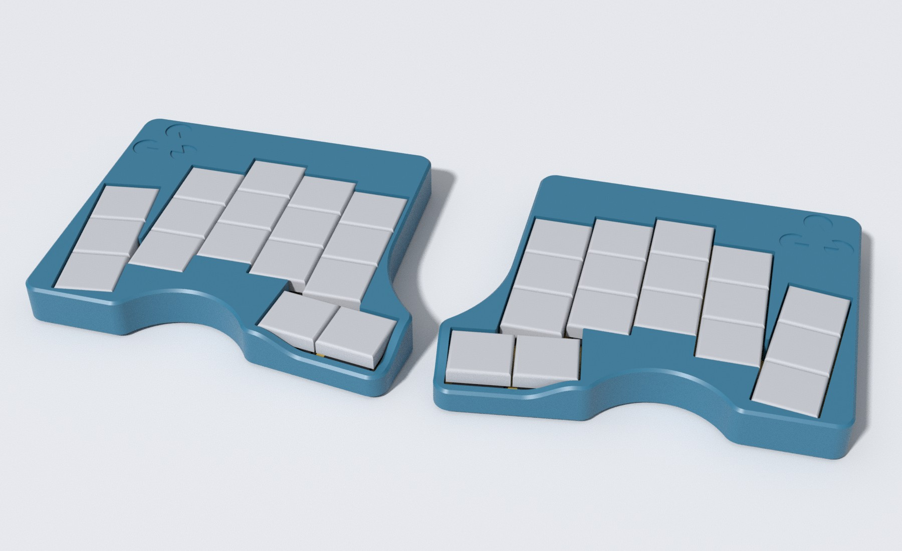
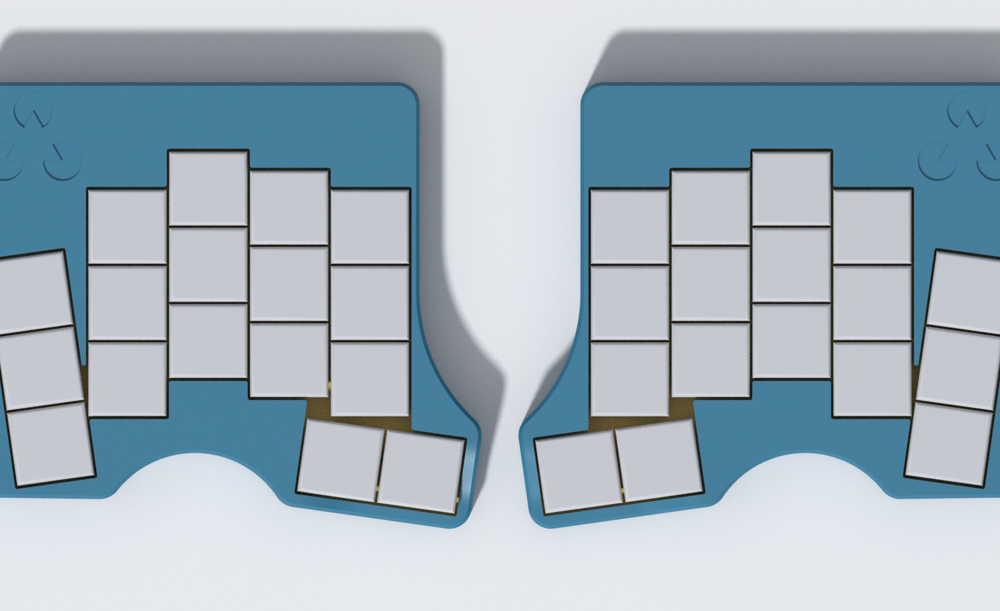
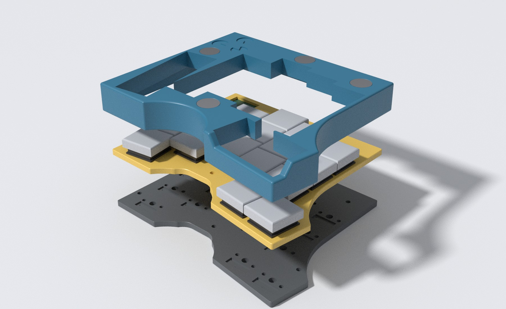
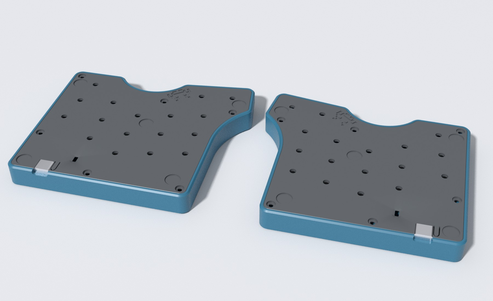

# duality_wave

A split, hand-wired, low-profile keyboard with a 3D-printed case.
Each half has 17 Kailh Choc keys and a Seeed XIAO nRF52840.
The case is generated from code, so you can change the layout and print it again.

## Status

The case design is in progress.
Nobody has printed or assembled the full case yet.
Fit values can still change after the first prints.
There is no firmware yet.
The images are renders, not photos.

## Features

- 17 keys per half: 3 rows of 5 finger columns and 2 thumb keys.
- 8 degree splayed pinky column, staggered finger columns and an angled thumb cluster.
- Low profile. Each half is about 113 x 97 x 14 mm.
- Protective walls around the keys for secure transportation
- Hand-wired. There is no PCB.
- One XIAO nRF52840, one LiPo battery and one slide power switch in each half.
- USB-C port on each half.
- A flexible lever in the bottom plate presses the XIAO reset button.
- Magnets hold the two halves together.
- Five rubber bumpers in each half.
- No snap fits. Heat-set inserts and M2 screws hold the case together.

## Bill of materials

Quantities are for both halves.

- 34 Kailh Choc v1 switches
- 34 low-profile keycaps with Choc spacing (17.45 x 16.45 mm), for example [Hattara](https://github.com/Pelicram/Hattara-Printable-Low-Profile-Keycaps)
- 2 Seeed XIAO nRF52840
- 2 LiPo batteries, 31 x 17 x 6 mm
- 2 slide power switches, 9 x 3.4 x 4 mm
- 16 magnets, 5 x 2 mm (two stacked in each of 8 recesses)
- 12 M2 heat-set inserts, 3.5 mm outer diameter, 2 mm long
- 12 low-profile M2 screws, 8 mm long
- 10 rubber bumpers, 8 mm diameter
- 34 diodes, one per key
- 0.1 mm to 0.2 mm enamelled wire

The Hattara keycaps are designed for SLS and MJF printing.
Check the repository of the keycaps for the files and the license.

## Printing

Each half has three printed parts.

- `keywell` is the top shell. Print it upside down.
- `keyplate` holds the switches. Print it upside down.
- `bottom` closes the case. Print it right side up.

Run `task build` to create the STEP files for all parts.
Run `task coupons` to create the calibration coupons.
Print the coupons first.
The fit depends on your printer, your material and your slicer.

## Assembly

1. Press an M2 heat-set insert into each of the six holes of the keywell. Press each insert in until it is flush with the keywell face.
2. Glue two magnets on top of each other into each magnet recess. See the section about polarity.
3. Wire the switches, the diodes, the XIAO, the power switch and the battery. Wiring is your choice. The keyplate has channels for the wire and the bottom plate has recesses for the switch pins and the diodes.
4. Put the keyplate into the keywell, then put the bottom plate on top. Fasten the six M2 screws from the bottom.
5. Put the rubber bumpers into their recesses.

Both halves are mostly mirror images of each other.

### Magnet polarity

Only the relative polarity matters.
Place the magnets in one half however you want.
Use a magnetized tool to make sure the magnets in the other half face the opposite way.
You cannot dry-fit the halves, because the magnets pull out of their recesses.

## Fit calibration

All fit constants live in `PrintProfile` in `src/duality_wave/models/print_profile.py`.
`CaseDimensions` carries one profile in `print_profile`.
The defaults match a Bambu Lab printer with PLA.
Change the profile for every new printer, material or slicer.

1. Run `task coupons`.
2. Print `build/coupons.stl` with the same settings as the final case.
3. Find the tightest fit that still goes together by hand.
4. Copy the winning values into a `PrintProfile`.

The coupons are built in their real print orientation.
They reuse the cutters from `models/features.py`.
The coupons fit on a 180 mm print bed.

| Coupon | Question |
| --- | --- |
| A, switch plate | Which switch cutout size is right? Does corner relief help? |
| B, plate in cavity | Which plate clearance is right? Try each plate both ways round. |
| C, round holes | Which magnet recess size and which insert pilot size is right? |
| D, pockets | Which XIAO pocket clearance is right? Does the battery fit? |

The case counters elephant foot with chamfers on the side that faces the print bed.
`plate_bed_chamfer` sets the chamfer on the plate faces.
`mouth_chamfer` sets the chamfer where switch cutouts and magnet recesses open towards the bed.
Sanding the plate edges along the z axis removes the layer ridges that rub on insertion.

## Build from source

Run `direnv allow` or `nix develop`.
The dev shell installs the Python dependencies with `uv`.

| Command | What it does |
| --- | --- |
| `task viewer` | Starts the OCP CAD viewer on port 3939. |
| `task build` | Builds the case with `duality_wave.cli.build` and exports STEP files. |
| `task compact` | Builds the compact variant with `duality_wave.cli.compact`. |
| `task coupons` | Exports `build/coupons.stl` and previews the coupons in the viewer. |
| `task render` | Renders the images in `docs/images` with Blender. |
| `task test` | Runs the unit tests. This takes about a minute. |

The STEP files go to `build/step` and `coupons.stl` to `build/`.
Git ignores the `build` directory.
The key layout comes from `ergogen/wave.yml`.
Run `task layout` after you change it. This runs ergogen and writes `ergogen/wave.points.yaml`. The build reads that file. Commit it.
`WaveCase(debug=True)` builds the accessory models and sends everything to the viewer.
The intermediate shapes arrive last, in a group named `debug` that starts hidden.
`WaveCase(debug=False)` builds only the printable parts.
The finished halves are `case.left` and `case.right`.

The Python code is the package `duality_wave` in `src/duality_wave/`.

- `cli/build.py` runs the main build.
- `cli/compact.py` builds a compact variant for test prints.
- `cli/render.py` exports the meshes for the images.
- `scripts/render_blender.py` renders the images inside Blender.
- `case.py` has `WaveCase`, which builds the three parts for each half.
- `builders/` holds one builder per part (`keywell.py`, `keyplate.py`, `bottom.py`).
- `builders/thumb_cut.py` builds the sculpted thumb slope of the keywell.
- `builders/side.py` places the parts on the left or right half.
- `builders/accessories.py` builds the models that are only shown in the viewer.
- `builders/viewer.py` decides what is pushed to the viewer.
- `layout.py` reads the `*.points.yaml` files that ergogen writes.
- `models/` holds the part models and the outline.
- `models/case_dimensions.py` holds the case dimensions of the main case and the compact variant.
- `models/features.py` holds the cutters that the case and the coupons share.
- `coupons.py` builds the calibration coupons.
- `paths.py` has the paths to the layouts and the `build` directory.
- `tests/` holds the unit tests.

This project is the descendant of the duality_particle.
Some names, for example `cirque_recess_*` in `models/outline.py`, still show that origin.

## License and credits

The code is licensed under the GPL-3.0. See `LICENSE`.
[Hattara keycaps](https://github.com/Pelicram/Hattara-Printable-Low-Profile-Keycaps) are by Pelicram under the TAPR Open Hardware License. They are not part of this repository.
The layout format is the one of [ergogen](https://github.com/ergogen/ergogen).
