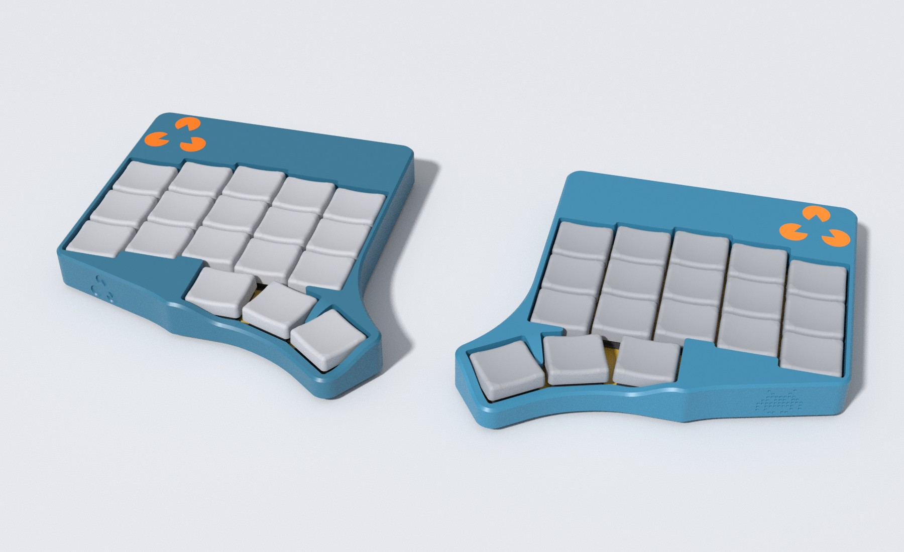
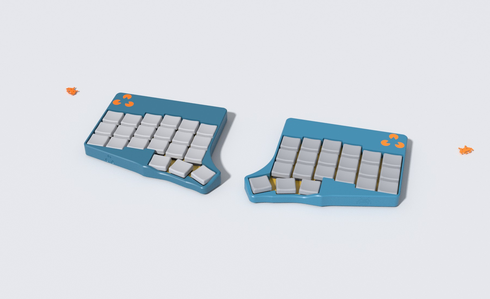
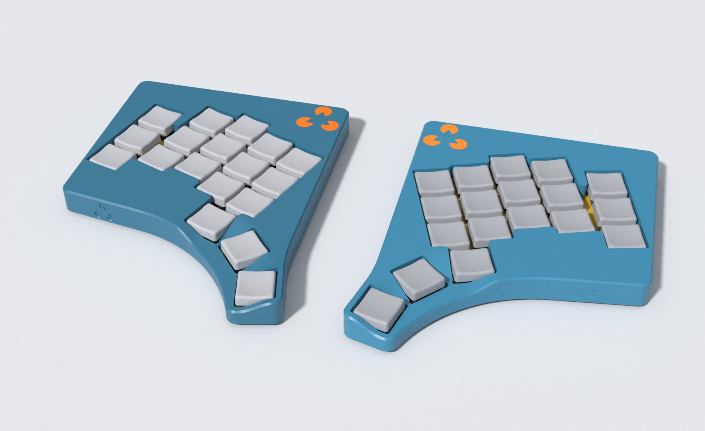
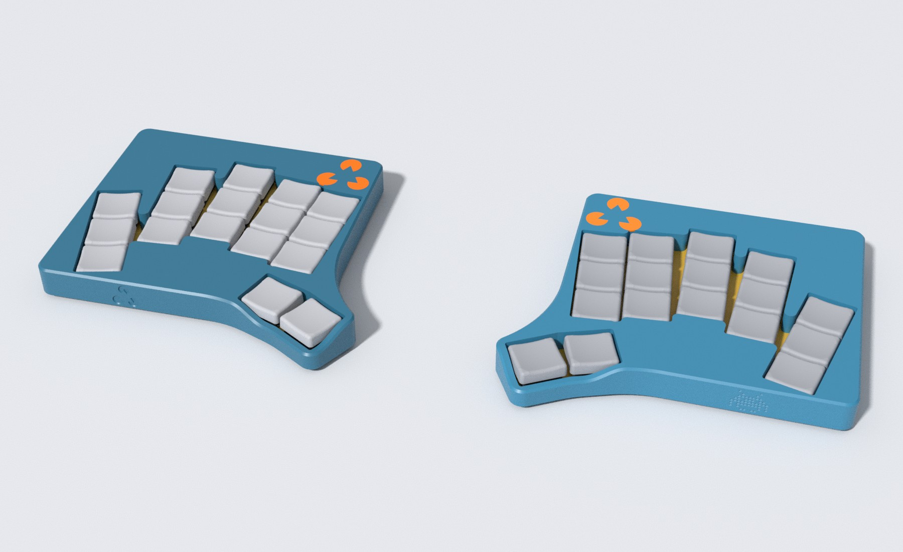
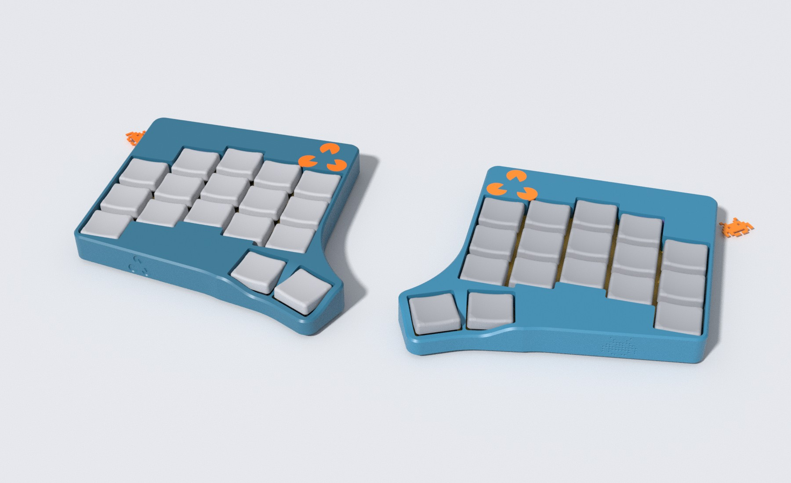
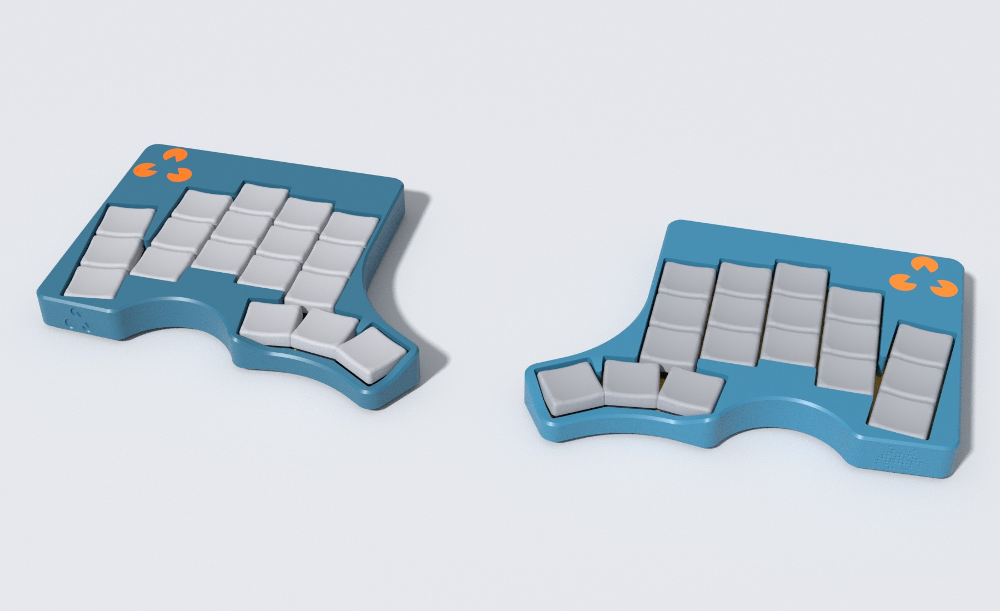
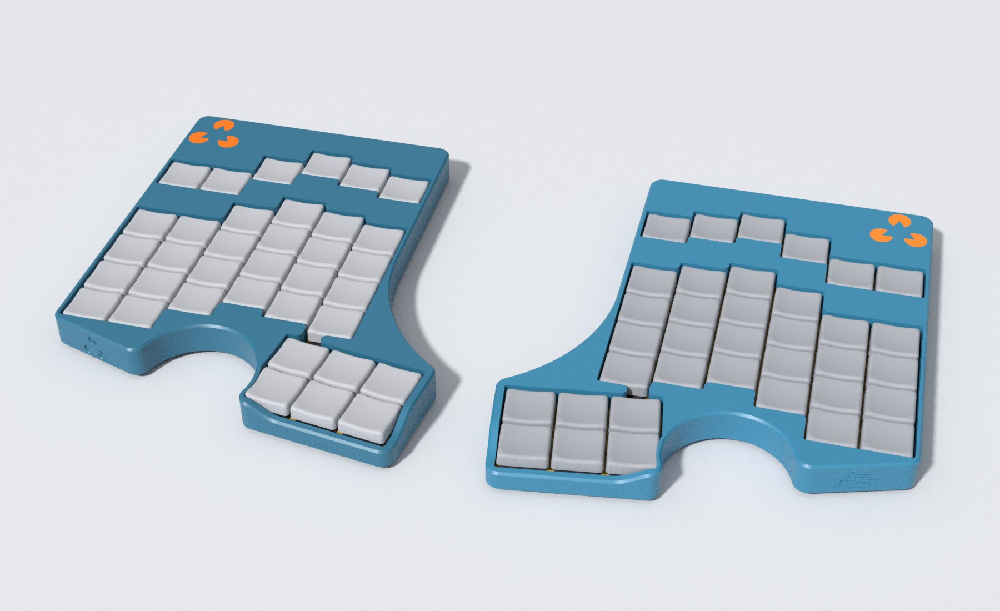

# Layouts

Chances are, if you can design it with ergogen, you can use the case generator to create a low profile handwiring case for that. So these are some examples showing popular layouts, recreated in ergogen. 
If you want to actually print them, some finetuning of the locations of screws, magnets or bumpers will be necessary - you can use the [CaseDimensions](/src/duality_wave/case_dimensions.py) for that.

There is however enough space for all the necessary hardware in these cases, so I guess everything would work? Please don't hesitate to reach out if you're interested in building one: I'm happy to support!

## Corne small

Small Corne-style layout with the outer column removed: 3 rows, 5 columns and 3 thumb keys per half.
Inspired by [foostan's Corne (crkbd)](https://github.com/foostan/crkbd#chocolate).

## Corne full

Full Corne-style layout: 3 rows, 6 columns and 3 thumb keys per half.
Inspired by [foostan's Corne (crkbd)](https://github.com/foostan/crkbd#chocolate).

## Absolem

Absolem-style layout with a strong column stagger and the iconic angled thumb arc of 3 keys.
Inspired by [MrZealot's Absolem](https://zealot.hu/absolem/), originally a unibody keyboard, now in a true split interpretation.

## A. dux (Architeuthis dux)

A. dux-style layout: 3 rows, 5 columns and 2 thumb keys per half, with strongly splayed columns.
Inspired by [tapioki's Architeuthis dux](https://github.com/tapioki/cephalopoda/tree/main/Architeuthis%20dux) 

## Ferris/Sweep

Ferris/Sweep-style layout: 3 rows, 5 columns and 2 thumb keys per half.
Inspired by [pierrechevalier83's Ferris](https://github.com/pierrechevalier83/ferris) and [davidphilipbarr's Sweep](https://github.com/davidphilipbarr/sweep).

## Thorne-like

The Duality Wave layout with a rounded thumb cluster inspired by [halfdane's (my own) thorne](https://github.com/halfdane/thorne-keyboard): the case follows the arc with a concave cutout.

### Big Iron

An absolutely massive layout with 6 columns and extra rows for numbers and function keys.
The thumb cluster is extra large with 2 rows of 3 keys each.